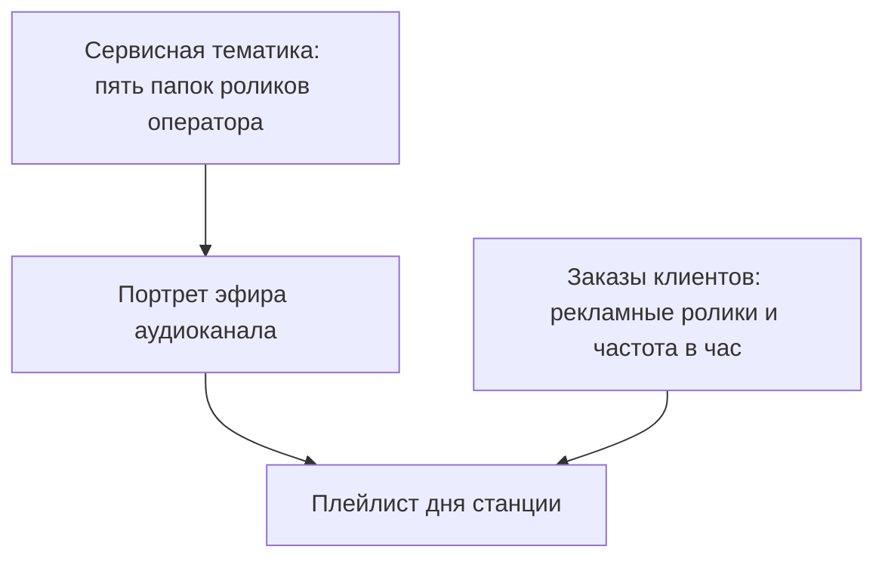

# Портрет эфира: как собирается аудиоплейлист станции

Короткая инструкция для презентации заказчику. Цифры в примере подобраны так, чтобы было видно правила сборки; это иллюстрация, а не выгрузка из конкретной станции.

Плейлист — программа одного дня одной станции. Её собирают из трёх заготовок: сервисной тематики, портрета эфира и активированных заказов клиентов.

Аудиостанция — это одна звуковая точка. У неё один канал вещания, и плейлист дня пишется на всю станцию. Часы программы считаются по часам работы точки, в её часовом поясе.

---

## 1. Сервисная тематика

Тематику ведёт оператор. Это набор служебных роликов одной темы, например «Голос торгового зала». Тема создаётся как аудио или как видео и дальше этот тип не меняется. В аудиотему кладутся только аудиофайлы.

У темы пять папок. Каждая папка — упорядоченный список роликов. На каждый выход блока берётся один следующий ролик папки, затем список идёт по кругу. В другой календарный день круг может начаться с другого ролика того же списка, поэтому один и тот же джингл не обязан открывать каждый день.

| Папка | Когда звучит |
|-------|----------------|
| Приветствие | В момент открытия точки, до первой рекламы |
| Сервисная шапка, начало | Перед роликами рекламного блока |
| Сервисная шапка, конец | Сразу после роликов этого блока |
| Завершение дня | В момент закрытия точки |
| Нейтральный контент | Во всё свободное время между этими событиями |

Шапка, приветствие и завершение дня могут быть короткими. Порог длины относится к нейтралке: по умолчанию в эфир не берётся нейтральный ролик короче 10 секунд. Оператор может снизить этот порог на портрете до 5 секунд.

---

## 2. Портрет эфира

Портрет — расписание каркаса дня для канала. Оператор один раз собирает шаблон и назначает его каналу. На аудиостанции канал один, поэтому портрет один.

Назначение тематики на портрет подключает все пять папок сразу: приветствие, обе шапки, завершение дня и нейтралку.

Портрет ещё задаёт два числа, которые видны в рекламе:

- какие частоты «раз в час» разрешены на этой точке — из ряда 1, 2, 3, 4, 5, 6, 10, 12, 20, 30;
- сколько рекламных роликов может стоять в одном блоке подряд. В типовом портрете это три.

Часы работы портрет не хранит. Их берёт у точки: пока точка закрыта, этот кусок дня в программу не попадает.

---

## 3. Заказы клиентов

Заказ — договорённость с клиентом: какие рекламные ролики, в каком порядке, сколько раз в час, в какие часы и дни, на какой станции.

Ролики заказа идут своим кругом, отдельно от служебных папок. Короткий рекламный ролик в эфир попадает: порог 10 секунд на рекламу не действует.

Пока заказ не активирован, в программе дня его нет. Активация занимает часы, где окно заказа пересекается с часами работы точки. Два коммерческих заказа могут делить один и тот же час одного канала. Программа дня после этого пересобирается.

Частота в плейлисте — это «сколько раз в час», а не отдельная цифра «показов за день» в документе заказа. Дневная цифра нужна для учёта. В эфир попадает частота.

---

## 4. Как из этого получается день

Сборка идёт по часам работы точки.

1. В секунду открытия звучит приветствие. Первый рекламный блок начинается сразу после него, а не поверх него.
2. Каждый рабочий час делится на равные отметки. Число отметок — наименьшее общее кратное частот заказов, которые занимают этот час. Оба клиента по 2 раза в час дают 2 отметки, то есть блок каждые 30 минут. Частоты 6 и 4 дают 12 отметок, то есть шаг 5 минут.
3. На отметке каждый попавший заказ отдаёт один следующий ролик своего списка. Если на одну отметку попали двое, их ролики стоят друг за другом, в порядке размещения. Весь этот кусок один раз оборачивается шапкой: джингл начала, ролики клиентов, джингл конца.
4. Если в одну отметку попало больше роликов, чем разрешает портрет, в блок входят первые по порядку размещения, не больше лимита.
5. Отметка, на которую не попал ни один заказ, рекламу не ставит. Промежуток до следующей занятой секунды заполняет нейтралка.
6. Нейтралка укладывается в свободное окно так: сначала самый длинный ролик, который ещё входит, затем следующий по длине из тех, что входят в остаток, и так по кругу, пока ещё какой-то ролик умещается. Хвост короче самого короткого подходящего ролика остаётся пустым.
7. В секунду закрытия звучит ролик завершения дня.

Пустой день, когда точка в этот день недели закрыта, даёт пустую программу: без приветствия, рекламы и завершения.

---

## 5. Пример. Аудиозал, утро и закрытие

Точка работает с 09:00 до 21:00. Тематика «Голос зала», портрет разрешает частоту 2 и не больше трёх рекламных роликов в блоке. Нейтралка не короче 10 секунд.

Служебные папки на этот день начинают круг с первого ролика:

| Папка | Ролики |
|-------|--------|
| Приветствие | «Доброе утро», 12 с |
| Шапка, начало | «Реклама 1», 5 с, затем «Реклама 2», 5 с |
| Шапка, конец | «Возвращаемся в зал», 4 с |
| Завершение дня | «До завтра», 15 с |
| Нейтралка | «Фон А» 30 с, «Фон Б» 20 с, «Фон В» 10 с |

Два активированных заказа, оба по 2 раза в час, оба на весь день работы:

| Клиент | Ролики по порядку | Частота |
|--------|-------------------|---------|
| Пекарня | «Булочки» 15 с, «Пироги» 15 с | 2 в час |
| Аптека | «Витамины» 10 с | 2 в час |

Общее кратное частот — 2. Рекламный блок встаёт в 09:00 и в 09:30, и так каждый час до закрытия. Оба клиента попадают на обе отметки.

### Открытие и первый блок

Приветствие занимает первые 12 секунд, поэтому реклама стартует в 09:00:12.

| Время | Что звучит | Откуда | Длина |
|-------|------------|--------|------:|
| 09:00:00 | Доброе утро | Приветствие | 12 с |
| 09:00:12 | Реклама 1 | Шапка, начало | 5 с |
| 09:00:17 | Булочки | Заказ «Пекарня» | 15 с |
| 09:00:32 | Витамины | Заказ «Аптека» | 10 с |
| 09:00:42 | Возвращаемся в зал | Шапка, конец | 4 с |
| 09:00:46 | Фон А, Фон Б, Фон В, снова Фон А… | Нейтралка | до 09:30:00 |

До 09:30 свободно 29 минут 14 секунд. Укладка нейтралки идёт пятёрками минут: 30 + 20 + 10. В такой остаток входит 29 полных троек и хвост 14 секунд. В хвост ещё входит «Фон В» (10 с). Последние 4 секунды короче любого ролика папки, поэтому перед 09:30 есть короткая пауза. Это нормальное поведение укладки, а не пропуск ролика.

### Следующая отметка, 09:30

Сетка часа не сдвигается из-за приветствия. Второй блок начинается ровно в половине.

| Время | Что звучит | Откуда | Длина |
|-------|------------|--------|------:|
| 09:30:00 | Реклама 2 | Шапка, начало, следующий ролик папки | 5 с |
| 09:30:05 | Пироги | Пекарня, следующий ролик заказа | 15 с |
| 09:30:20 | Витамины | Аптека, в папке один ролик, круг начинается снова | 10 с |
| 09:30:30 | Возвращаемся в зал | Шапка, конец | 4 с |
| 09:30:34 | Нейтралка по тому же правилу | Нейтральный контент | до 10:00:00 |

Дальше час за часом то же самое: в :00 и в :30 блок из шапки, следующего ролика пекарни, ролика аптеки и шапки конца, между ними нейтралка. После «Пирогов» пекарня снова даёт «Булочки».

### Закрытие

| Время | Что звучит | Откуда | Длина |
|-------|------------|--------|------:|
| 21:00:00 | До завтра | Завершение дня | 15 с |

Ролик завершения начинается в секунду закрытия и доигрывает уже после конца рабочего окна.

---

## 6. Если на встрече спросят про разные частоты

Пекарня заказала 6 раз в час, аптека — 4. Портрет эти частоты разрешает. Час делится на 12 отметок, шаг 5 минут.

- Пекарня звучит на каждой второй отметке: 09:00, 09:10, 09:20, 09:30, 09:40, 09:50.
- Аптека — на каждой третьей: 09:00, 09:15, 09:30, 09:45.
- В 09:00 и в 09:30 они встречаются в одном блоке: одна шапка начала, ролик пекарни, ролик аптеки, одна шапка конца.
- В 09:05, 09:25, 09:35 и 09:55 рекламы нет, промежуток забирает нейтралка.
- На одинокой отметке шапка всё равно оборачивает единственный ролик.

---

## 7. Что меняет уже собранный день

Программа пересобирается, когда оператор или клиент меняет то, из чего она собрана: активирует или снимает заказ, заменяет ролик в заказе, меняет ролики тематики, портрет или часы работы точки. Станция забирает уже готовую программу дня и играет её по времени.
